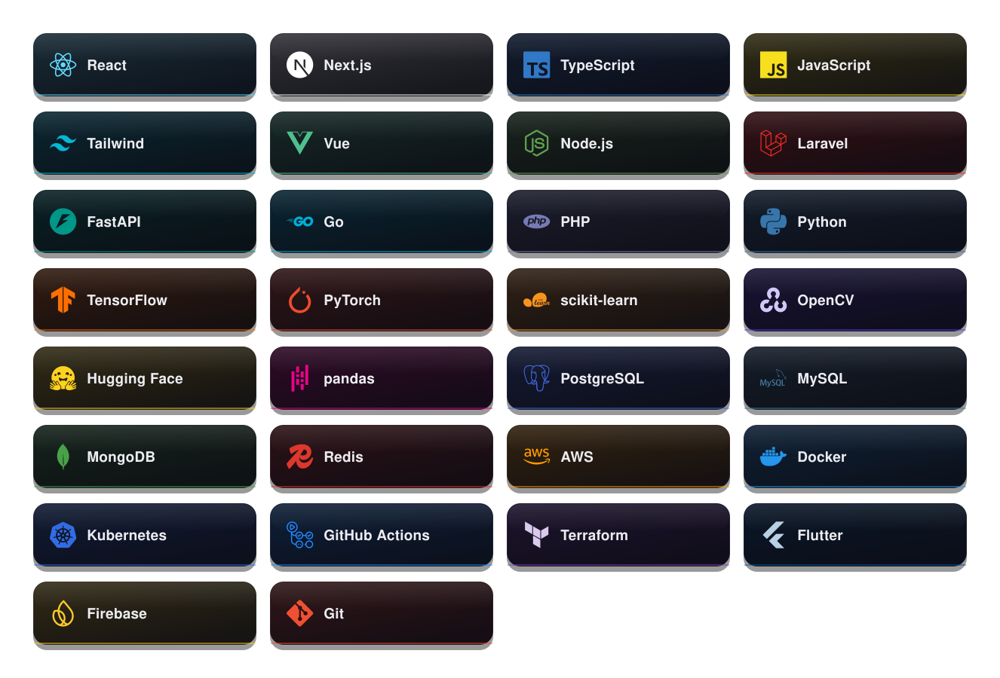
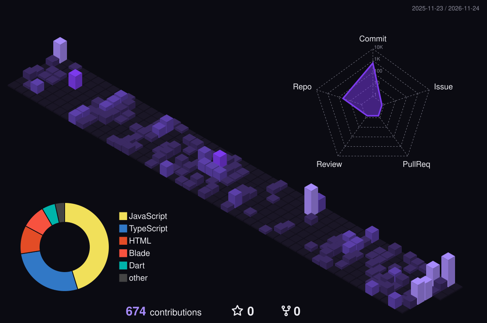
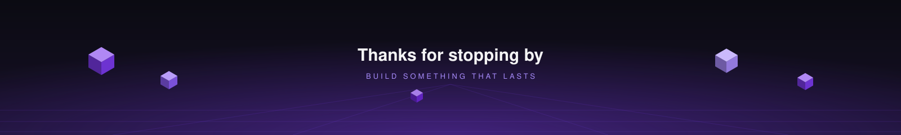

<!-- 3D hero -->


<h1 align="center">Faiz here </h1>

<h3 align="center">Namaste 🙏 I'm Muhammad Faiz Ramadhan</h3>

<div align="center">


</div>


<table>
<tr>
<td width="55%" valign="top">

- 🚀 Building **intelligent, scalable systems** that bridge AI and production-grade engineering
- 💻 Working across **frontend, backend and web design** — from React/Next.js to distributed services
- 🎓 Currently pursuing a degree in **Computer Science**
- 🧠 Deploying **LLMs, computer vision pipelines and predictive models** into real applications
- ⚙️ Deep into **DevOps culture** — CI/CD, container orchestration, infrastructure as code
- 🤝 Open to **senior/staff engineering roles, AI/ML engineering, technical consulting** and open source
- ✨ I only like the perfection

<br>

[](https://faizramadhan.vercel.app)
[](https://www.linkedin.com/in/muhammad-faiz-ramadhan-215a3625b/)
[](mailto:faizramadhan021104@gmail.com)
[](https://github.com/Muhfaizr21)

</td>
<td width="45%" align="center" valign="middle">


</td>
</tr>
</table>


<div align="center">



</div>


<div align="center">


<br>


</div>


<div align="center">

<table>
<tr>
<td align="center" width="50%">

<a href="https://github.com/Muhfaizr21/BISINDO-Mobile">
  
</a>

</td>
<td align="center" width="50%">

<a href="https://github.com/Muhfaizr21/manajemen-inventaris-barang">
  
</a>

</td>
</tr>
<tr>
<td align="center" width="50%">

<a href="https://github.com/Muhfaizr21/kinetics-vision">
  
</a>

</td>
<td align="center" width="50%">

<a href="https://github.com/Muhfaizr21/SiapTerbang">
  
</a>

</td>
</tr>
</table>

</div>


<div align="center">



</div>


<div align="center">


</div>


<div align="center">
  <picture>
    <source media="(prefers-color-scheme: dark)" srcset="https://raw.githubusercontent.com/Muhfaizr21/Muhfaizr21/output/github-contribution-grid-snake-dark.svg?v=3">
    
  </picture>
</div>


<div align="center">

[](https://leetcode.com/faizramadhan)
[](https://auth.geeksforgeeks.org/user/faizramadhan)
[](https://www.hackerrank.com/faizramadhan)

</div>


```yaml
learning:
  - "Distributed Systems (DDIA)"
  - "Advanced MLOps (Kubeflow, Ray)"
  - "Rust for high-performance tooling"

building:
  - "Open source RAG evaluation framework"
  - "Personal cloud cost optimizer (AWS + Terraform)"

exploring:
  - "Multi-modal AI agents"
  - "WebAssembly for edge inference"

open_to:
  - "Senior full-stack / AI engineering roles"
  - "Technical writing & speaking opportunities"
  - "Open source collaborations"
```


