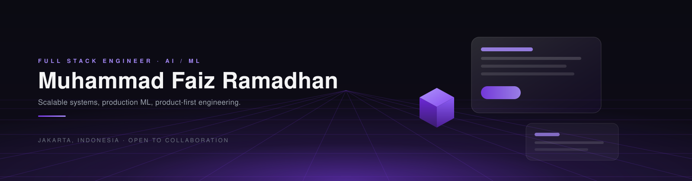

<!-- 3D hero -->

<table>
<tr>
<td width="55%" valign="top">

- 🚀 Building **intelligent, scalable systems** that bridge AI and production-grade engineering
- 💻 Working across **frontend, backend and web design** — from React/Next.js to distributed services
- 🎓 Currently pursuing a degree in **Computer Science**
- 🧠 Deploying **LLMs, computer vision pipelines and predictive models** into real applications
- ⚙️ Deep into **DevOps culture** — CI/CD, container orchestration, infrastructure as code
- 🤝 Open to **senior/staff engineering roles, AI/ML engineering, technical consulting** and open source
- ✨ I only like the perfection

 

</td>
<td width="45%" align="center" valign="middle">

